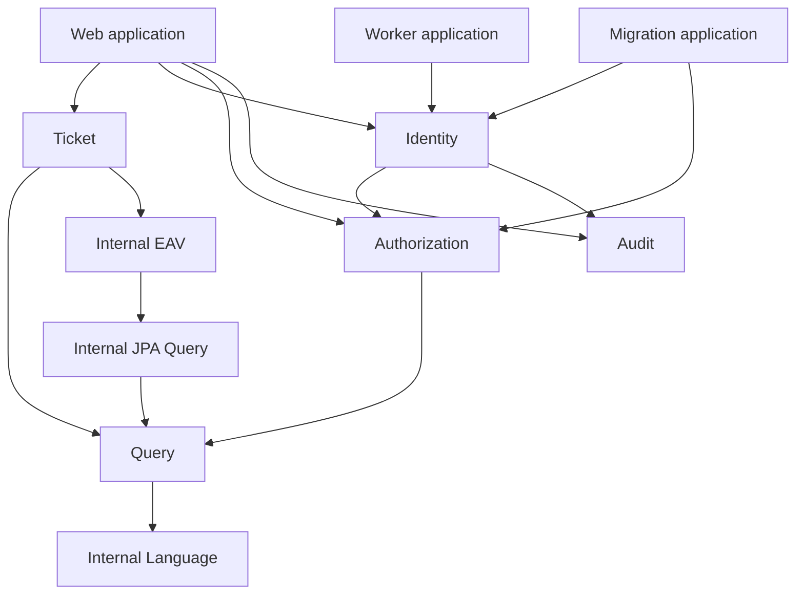

# 11. Appendices

Examples illustrate the required dependency direction and specialized cases. They do not expand the normative module graph or public API surface.

## 11.1 Dependency Direction



**Interpretation:** The diagram is illustrative; [Gradle dependencies](08-requirements-allocation-and-dependencies.md) specify the complete project edge set.

## 11.2 Tactical Package Convention

```text
feature/
  domain/           # Business invariants, no framework
  application/      # Use cases, public contracts and concrete transactional services
  persistence/      # ORM mappings and repository implementations
  configuration/    # Runtime bean composition when needed
```

Only responsibilities actually present need a package. Supporting libraries MAY use a simpler organization.

## 11.3 Example Specialized Transaction

[MigrationInstaller](https://github.com/taskmigo/taskmigo/blob/9c1cd242fe4c5210fdd8dd88311e328a3784d0e1/server/apps/migration/src/main/java/io/taskmigo/migration/installation/MigrationInstaller.java) uses `SERIALIZABLE` and bounded retry as a specialized installation boundary; ordinary reusable application services do not require a shared callback transaction-runner abstraction.
