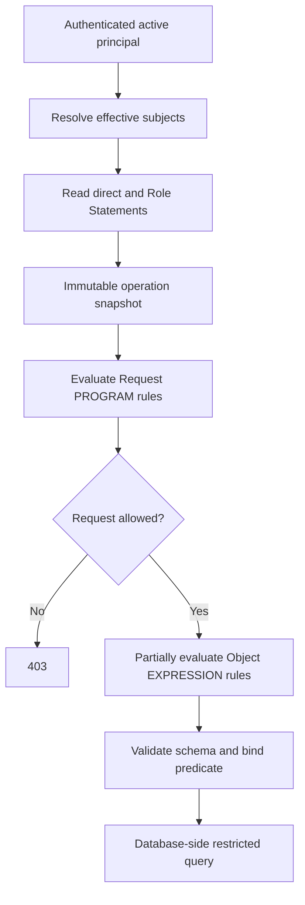

# 11. Appendices

Examples clarify policy inputs and allow/deny composition; they do not extend the supported grammar or available HTTP routes.

## 11.1 Request and Object Flow



## 11.2 Policy Source Examples

Request policy source:

```text
return principal.username == "system";
```

Object policy source:

```text
object.status == "RETAINED"
```

Each example requires a matching Statement effect/scope/target and schema-allowed field; the first is not an implicit authentication bypass.

## 11.3 Matching

`/api/v0/users/.*` is a supported target pattern; the matcher evaluates a full path without the query string and applies the Statement's method or `*` wildcard.
