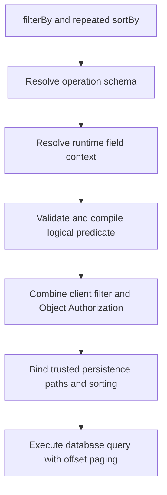

# 11. Appendices

## 11.1 Example Request

```text
GET /api/v0/tickets?ticketTypeId=<UUID>&filterBy=object.status%20%3D%3D%20%22OPEN%22&sortBy=-updatedAt&sortBy=title&page=1&pageSize=20
```

This example requires URL encoding of the filter expression and fields supported by that operation's schema.

## 11.2 Sort Semantics

```text
sortBy=title
sortBy=-createdAt
```

Results SHALL be ordered title ASC, then createdAt DESC. For nullable sortable fields, NULLS LAST applies.

## 11.3 Query Pipeline



## 11.4 Invalid Expressions

`object.name == object.alias`, `"alice" == object.name`, `object.name in ["alice"]`, and `sortBy=+name` are intentionally outside the implemented query contract.

## 11.5 Static Operation Capability Matrix

The following table is the **normative static query contract** for the current API v0 list operations. Backend Query Schemas and generated OpenAPI `x-filter-by`/`x-sort-by` metadata SHALL conform to it, rather than define it. Operators separated by commas apply to the entire named field group.

<!-- prettier-ignore -->
| GET collection       | Fields and supported operators                                                                                                       | Sortable fields                                                   |
| -------------------- | ------------------------------------------------------------------------------------------------------------------------------------ | ----------------------------------------------------------------- |
| `/api/v0/users`      | `id`, `status`: EQ, NE • `username`, `firstName`, `lastName`: EQ, NE, CONTAINS • `retainedAt`: EQ, NE, GT, GTE, LT, LTE              | `id`, `username`, `firstName`, `lastName`, `status`, `retainedAt` |
| `/api/v0/tickets`    | `id`, `ticketTypeId`, `createdBy`: EQ, NE • `title`, `status`: EQ, NE, CONTAINS • `createdAt`, `updatedAt`: EQ, NE, GT, GTE, LT, LTE | `title`, `status`, `createdAt`, `updatedAt`                       |
| `/api/v0/statements` | `id`: EQ, NE • `code`, `description`, `method`, `path`: EQ, NE, CONTAINS                                                             | `id`, `code`, `description`, `method`, `path`                     |
| `/api/v0/roles`      | `id`: EQ, NE • `code`, `displayName`, `description`: EQ, NE, CONTAINS                                                                | `id`, `code`, `displayName`, `description`                        |
| `/api/v0/groups`     | `id`: EQ, NE • `code`, `displayName`, `description`: EQ, NE, CONTAINS                                                                | `id`, `code`, `displayName`, `description`                        |

For Statements, `method` and `path` are the query aliases, even though the response nests them under `target.api`. Ticket custom fields can extend the static Ticket list schema through its server-resolved runtime EAV context, as defined by [TKT-FR-013](../006.%20Tickets%20and%20Dynamic%20Fields/04-functional-and-behavioral-requirements.md#tkt-fr-013--runtime-query-field-snapshots).

The current `GET /api/v0/ticket-types` and `GET /api/v0/audit/{entityType}/logs` operations do not expose `filterBy` or `sortBy`.

## 11.6 Object Authorization Field Scopes

These operation schemas are for authorizing a target, not public `filterBy` query parameters.

<!-- prettier-ignore -->
| Operation                           | Approved static Object paths and operators                                                                                                                                                               |
| ----------------------------------- | -------------------------------------------------------------------------------------------------------------------------------------------------------------------------------------------------------- |
| `identity.users.delete`             | `id`, `status`: EQ, NE • `username`: EQ, NE, CONTAINS • `retainedAt`: EQ, NE, GT, GTE, LT, LTE                                                                                                           |
| `identity.users.update-statements`  | `id`, `status`: EQ, NE • `username`: EQ, NE, CONTAINS                                                                                                                                                    |
| `tickets.read` and `tickets.update` | `id`, `ticketTypeId`, `createdBy`: EQ, NE • `title`, `status`: EQ, NE, CONTAINS • `createdAt`, `updatedAt`: EQ, NE, GT, GTE, LT, LTE • Compatible dynamic fields from the Ticket's pinned schema version |

The [resource-specific Query Schemas](https://github.com/taskmigo/taskmigo/tree/9c1cd242fe4c5210fdd8dd88311e328a3784d0e1/server/modules) are the implementation evidence; neither this table nor static OpenAPI replaces runtime metadata resolution.

## 11.7 Runtime Ticket Field Syntax

Resolved Ticket custom fields use the logical path `object.<fieldKey>` directly, not `object.customFields.<fieldKey>`, because the EAV binder exposes each field key as a top-level logical query path. A compatible STRING custom field with key `severity` can be filtered as `contains(object.severity, "HIGH")` when its runtime context includes that field.

Availability depends on the global, Type-scoped or Ticket-pinned historical query context; static OpenAPI cannot enumerate runtime field keys. See the [EAV JPA field binding](https://github.com/taskmigo/taskmigo/blob/9c1cd242fe4c5210fdd8dd88311e328a3784d0e1/server/modules/internal/eav/src/main/java/io/taskmigo/eav/value/persistence/EavJpaQueryFieldFactory.java).
