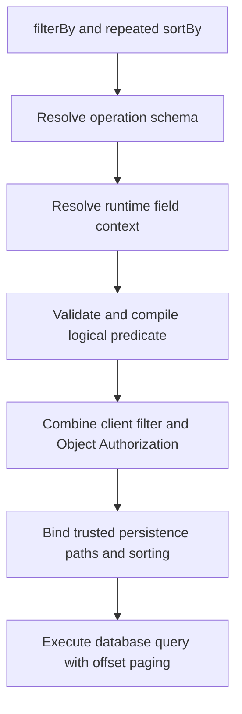

# 11. Appendices

## 11.1 Example Request

```text
GET /api/v0/tickets?ticketTypeId=<UUID>&filterBy=object.status%20%3D%3D%20%22OPEN%22&sortBy=-updatedAt&sortBy=title&page=1&pageSize=20
```

This example requires URL encoding of the filter expression and fields supported by that operation's schema.

## 11.2 Sort Semantics

```text
sortBy=title
sortBy=-createdAt
```

Results SHALL be ordered title ASC, then createdAt DESC. For nullable sortable fields, NULLS LAST applies.

## 11.3 Query Pipeline



## 11.4 Invalid Expressions

`object.name == object.alias`, `"alice" == object.name`, `object.name in ["alice"]`, and `sortBy=+name` are intentionally outside the implemented query contract.
