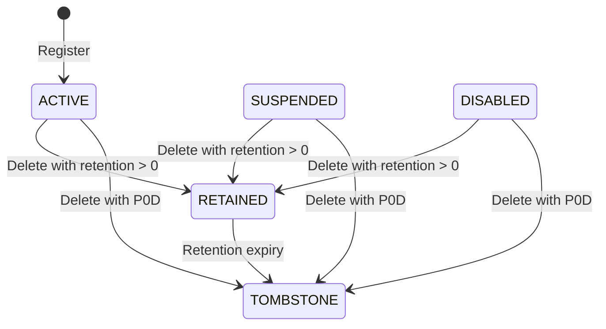

# 11. Appendices

State and JSON examples illustrate the implemented lifecycle; diagrams do not introduce additional public transition endpoints.

## 11.1 User State Lifecycle



The diagram shows implemented deletion transitions, not a public API for changing ACTIVE/SUSPENDED/DISABLED. TOMBSTONE has no normal outgoing transition.

## 11.2 Configuration Examples

```json
{
  "retention": {
    "user": "P30D"
  }
}
```

`PT24H` is a valid incoming ISO-8601 duration representing one day, serialized as `P1D`. `P0D` means immediate tombstoning.

## 11.3 Privacy Changes

The tombstone path marks `username`, `firstName`, `lastName`, `emails`, `passwordHash`, `roleIds`, `statementIds`, `groupIds`, and `sessions` as sensitive in its deletion audit event; their previous/new values are omitted.
