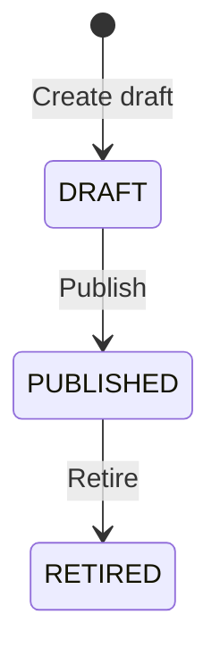
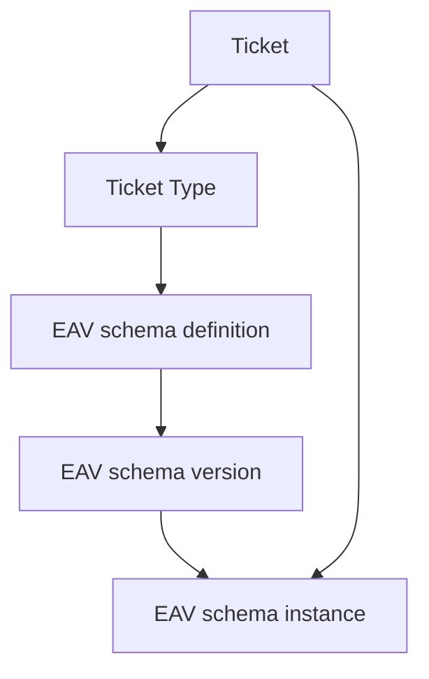

# 11. Appendices

## 11.1 Schema Version Lifecycle



A new draft MAY be created from the current schema version. Historical Tickets remain pinned to their own version.

## 11.2 Ticket Storage



## 11.3 Type and Field Example

```json
{
  "key": "bug",
  "name": "Bug"
}
```

```json
{
  "fields": [
    {
      "key": "severity",
      "label": "Severity",
      "dataType": "ENUM",
      "required": true,
      "constraints": { "options": ["LOW", "MEDIUM", "HIGH"] }
    }
  ]
}
```

Examples describe request shapes and do not imply pre-created Types.
