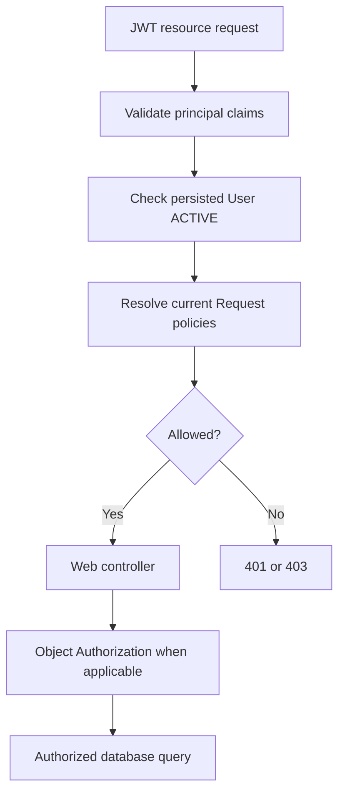
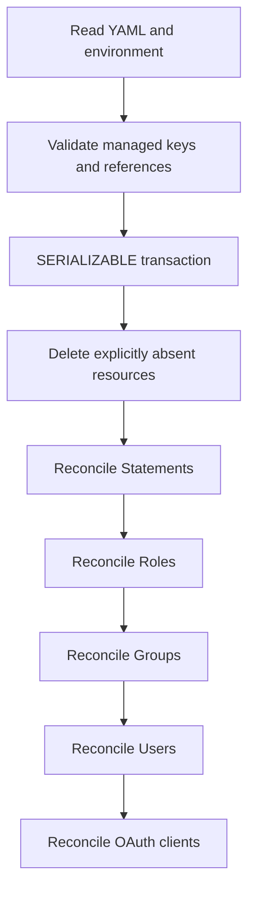

# 11. Appendices

## 11.1 Request Authorization Flow

## 11.2 Managed Resource Reconciliation

## 11.3 Security Defaults

The managed browser OAuth client uses PKCE, authorization-code and refresh-token grants, five-minute access tokens, eight-hour non-reusable refresh tokens; server session default inactivity is 30 minutes. These are configuration defaults, not guarantees for external clients.

## 11.4 Provisioned Role and Policy Matrix

This is the concrete [managed role](https://github.com/taskmigo/taskmigo/blob/9c1cd242fe4c5210fdd8dd88311e328a3784d0e1/server/apps/migration/src/main/resources/migration/roles.yaml), [Statement](https://github.com/taskmigo/taskmigo/blob/9c1cd242fe4c5210fdd8dd88311e328a3784d0e1/server/apps/migration/src/main/resources/migration/statements.yaml), [User](https://github.com/taskmigo/taskmigo/blob/9c1cd242fe4c5210fdd8dd88311e328a3784d0e1/server/apps/migration/src/main/resources/migration/users.yaml) and [Group](https://github.com/taskmigo/taskmigo/blob/9c1cd242fe4c5210fdd8dd88311e328a3784d0e1/server/apps/migration/src/main/resources/migration/groups.yaml) snapshot; it is not an implicit hardcoded superuser bypass.

| Managed resource       | Bound behavior                                                                                                                                                      |
| ---------------------- | ------------------------------------------------------------------------------------------------------------------------------------------------------------------- |
| `system-operator` Role | Request ALLOW for versioned APIs • GET Object ALLOW for versioned APIs • User delete/statement-update Object ALLOW with explicit retained/system-related DENY rules |
| `administrator` Role   | Broad Request and GET Object ALLOW • Same User delete/statement-update guards • Additional Object DENY hiding `username == "system"` on `/api/v0/users`             |
| `basic-user` Role      | No direct Statements in the managed resource                                                                                                                        |
| `global` Group         | Bound to `basic-user` Role                                                                                                                                          |
| `system` User          | Explicitly assigned `system-operator` and `global`; password from `TM_SYSTEM_PASSWORD`                                                                              |
| `admin` User           | Explicitly assigned `administrator` and `global`; no initial password in the shipped managed User entry                                                             |

The runtime `POST /api/v0/users` use case does not automatically assign `global` or any Role, and it does not initialize an interactive password.
