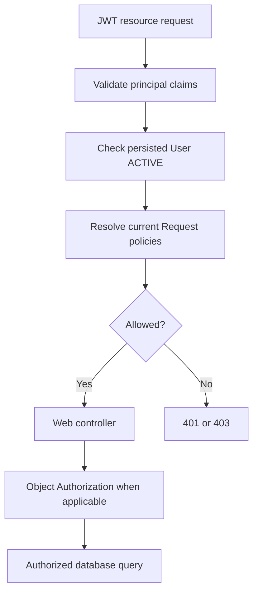
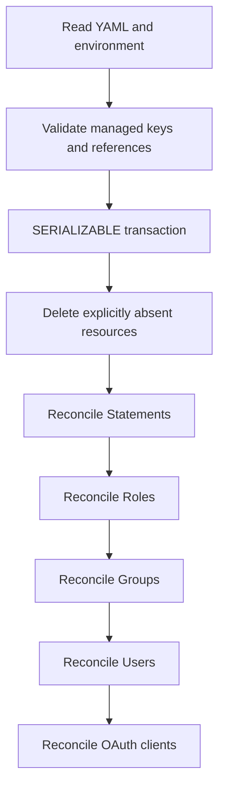

# 11. Appendices

The diagrams illustrate validated request and installation flows; the managed defaults may vary by deployment configuration.

## 11.1 Request Authorization Flow

## 11.2 Managed Resource Reconciliation

## 11.3 Security Defaults

The managed browser OAuth client uses PKCE, authorization-code and refresh-token grants, five-minute access tokens, eight-hour non-reusable refresh tokens; server session default inactivity is 30 minutes. These are configuration defaults, not guarantees for external clients.
